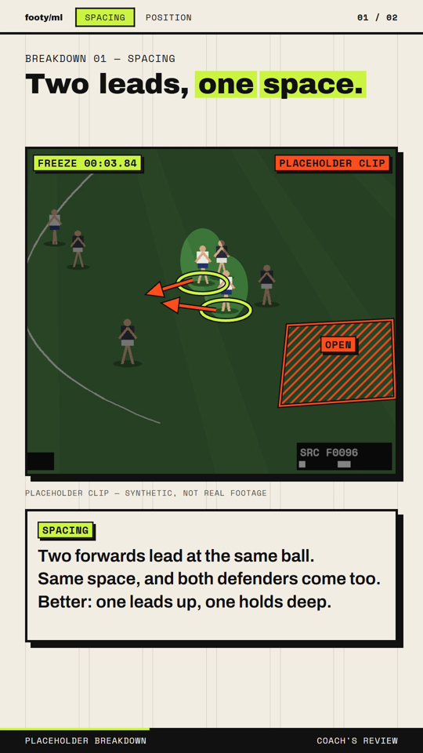
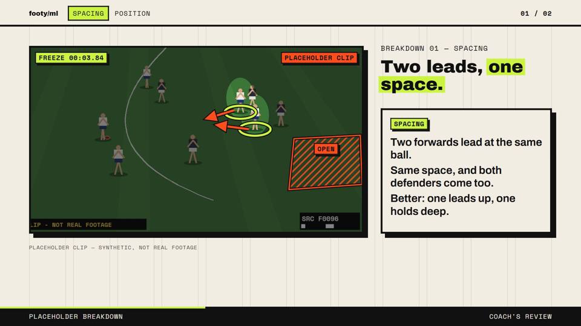

# Footy breakdown

A coach-style review of match footage for the footy/ml page: play the clip, freeze on the
exact frame, dim, draw on it, explain in a short calm caption, then play the moment out.
It renders in the page's neo-brutal look at 1080×1920 (`--preset vertical`) and 1080p30.

<p>


</p>

*The example is a **synthetic placeholder clip** (labelled in every frame), not real footage.*

```
clip file ─► ingest ─► scan ─► vision pass ─► check ─► YOU APPROVE ─► build ─► render ─► verify
 (yours)     proxy +    cheap    sheets +      moments.md    approve      project    mp4     exact
             source log signals  grid frames   + proofs      (hash)       JSON               freezes
```

## Sourcing (your step)

- The pipeline **never downloads** and must not be pointed at ripping tools. Save a clip
  yourself, only if you have the right to use it, into `media/afl-breakdown/` (git-ignored).
- Keep it short: the moment plus its lead-in and outcome (`--in`/`--out` trims; over 45 s warns).
- Every clip's source, competition, match, date, broadcaster and time range is logged in the
  moments file and copied into the project's `meta.sources`. `rights` starts `unchecked`;
  `check` keeps warning until you set it to `cleared` or `own`.

## Run it from a clip

```bat
rem 1. proxy + source log (frames are numbered on this proxy from here on)
videoeditor_venv\Scripts\python -m studio.footy ingest media\afl-breakdown\my-clip.mp4 --slug r5-spacing ^
    --in 00:12:03.0 --out 00:12:21.0 --url "<where it came from>" --competition AFL ^
    --match "<as the source names it>" --date 2026-04-12 --broadcaster "<broadcaster>"

rem 2. cheap signals -> ranked candidates, contact sheets, grid frames, brief.md
videoeditor_venv\Scripts\python -m studio.footy scan media\afl-breakdown\r5-spacing\moments.json
```

3. **Vision pass.** In a Claude Code session: *"Do the vision pass in
   media/afl-breakdown/r5-spacing/scan/brief.md."* The brief sets the rules: describe only what
   is visible; every statement is a claim marked `seen` / `likely` / `unsure` with the frames that
   show it; list what the footage cannot show; never invent players, names, numbers, scores or
   rules; drop a moment with no clear teaching point. Exact frames with a pixel grid for placing
   marks: `python -m studio.footy frames <moments.json> --clip c1 --at 96,120 --grid`.

```bat
rem 4. validate; writes moments.md (review summary) and proofs\ (marks on the raw freeze frame)
videoeditor_venv\Scripts\python -m studio.footy check media\afl-breakdown\r5-spacing\moments.json
```

5. **Review — the pipeline stops here.** Read `moments.md`, look at `proofs/`, fix anything in
   `moments.json` (positions flagged **ADJUST?** first), re-run `check`, then approve:

```bat
videoeditor_venv\Scripts\python -m studio.footy approve media\afl-breakdown\r5-spacing\moments.json --by "<you>"
rem 6. build refuses unless approved AND unchanged since (sha256 of everything but the review block)
videoeditor_venv\Scripts\python -m studio.footy build media\afl-breakdown\r5-spacing\moments.json
render.bat projects\afl-breakdown.json --preset vertical
render.bat projects\afl-breakdown.json --preset 1080p30
rem 7. every freeze shows exactly its frame (render report + decode check)
videoeditor_venv\Scripts\python -m studio.footy verify renders\afl-breakdown\afl-breakdown_vertical.mp4
```

Test without footage: `python -m studio.footy placeholder` makes and ingests the synthetic clip.
`docs/footy/placeholder.moments.json` is the finished example
(summary: [placeholder.moments.md](footy/placeholder.moments.md)).

## The moments file (`vidkit.footy-moments` v1)

Schema and checks: `studio/footy/moments.py`. Frames are **proxy frames**; positions are
**proxy pixels** (video coordinates).

| block | what it holds |
|---|---|
| `clips[]` | `id`, `proxy`, `fps`, `frames`, `width`, `height`, `audio_file`, `placeholder`, `source` {`kind`, `url`, `file`, `competition`, `match`, `date`, `broadcaster`, `time_range` {`in`, `out`}, `rights`, `notes`} |
| `candidates[]` | from `scan`: window, peak, score, `signals[]` (which fired, z, what it may mean); from the vision pass: `visible`, `why`, `vision_rank`, `status` chosen/dropped, `drop_reason` |
| `moments[]` | `in_f` → `freeze_f` → `out_f` (+ `slow_until_f`), `title` (`[[lime]]` / `{{orange}}` markup), `category` (positioning, spacing, contest, decision, technique), `teaching_point`, `claims[]` {`id`, `text`, `confidence`, `frames`}, `cannot_tell[]`, `captions` {`watch`, `freeze[≤3]`, `outcome`, each {`text`, `claims[]`}}, `tracks`, `annotations`, `camera`, `playback`, `voice` |
| `audio` | footage sound in 1× segments (`footage_gain_db`), music bed, freeze tick |
| `review` | `status`, `by`, `at`, `hash` — written by `approve` |

**Tracks** — `{label, point: feet|body|ball|focus, interp: smooth|ease|linear|hold, source: vision|manual|cv, keys: [{f, x, y, w?, h?, conf?}]}`.
Sparse hand keys and dense tracker output use the same shape, so a CV tracker can write
`source: "cv"` samples with boxes and confidence later without any renderer change.
`smooth` is Catmull-Rom through every key, easing in and out at the ends; `ease` stops on each key.

**Annotations** — every one cites the claims it illustrates; `adjust: true` + `note` flags a
proposed position for you to check.

| kind | needs | draws |
|---|---|---|
| `ring` | `track` or `at`, `r` | ellipse at the feet; the player stays bright through the dim (`spot: false` to turn off) |
| `spotlight` | `track` or `at`, `r` | a lit oval in the dim around the body |
| `arrow` | `from`, `to`, optional `via` (curve) | direction of a run, kick or ball |
| `line` | `from`, `to`, `dash` | a gap or spacing, with end ticks |
| `zone` | `points[3+]` | hatched area (space, a corridor) |
| `label` | `at`, `text`, `dx`/`dy` | chip with a leader line |

Points are `{x, y}` or `{track, dx?, dy?}`. `when`: `freeze` (default), `follow` (stays on through
the play-out, following its track), `play` (also in the lead-in), `all`. Shared fields: `color`
(lime, orange, cobalt, paper, ink), `label`.

## Timing and frame exactness

- `frontend/renderer/breakdown/timing.js` builds the plan in whole output frames; every segment
  re-anchors its source position, so nothing drifts. The freeze starts on the first output frame
  where the playhead reaches `freeze_f` and shows exactly that frame for the whole hold.
  Tests: `frontend/tests/breakdown.test.mjs` (25, 29.97, 30, 50, 60 fps sources).
- Hold length = reading time of the freeze captions (1.0 s + 0.26 s a word, plus 0.3 s an
  annotation), 3–8 s, or `playback.hold_s`, and never shorter than a `voice` line.
- The proxy is **video only, constant frame rate, every frame a keyframe, first frame at
  t = 0**. Its audio goes to `<clip>-audio.wav`. This matters: the renderer's frame decoder
  (`studio/render/vframes.py`) seeks to `frame / fps`, so a video stream that starts late (an
  AAC track's priming delay does this) shows every frame one late. `ingest` refuses a proxy
  that doesn't start at 0, and `verify` compares the renderer's decode of each freeze frame
  with an exact frame-count decode.

## What it does not do (yet)

- **The vision pass is a Claude session reading sampled frames**, not a script. It can misread
  an angle or a jersey, which is why every claim carries a confidence and evidence frames and
  nothing renders before you approve.
- **No tracking.** Tracks are positions read off grid frames and interpolated; between keys a
  ring can drift off a player who changes direction. The format is ready for tracker output.
- The cheap signals only pick where to look. The crowd signal also fires on kick thuds and
  commentary; motion concentration fires on close-ups. On the synthetic clip the pan signal's
  z-scores saturate because the drawn camera never jitters.
- Slow motion repeats frames (no interpolation). Footage sound plays only in 1× segments.
- No text-to-speech: `voice` takes a recorded file and lengthens the hold to fit it.
- The name, number and score checks are pattern flags for you to read, not proof of absence.
