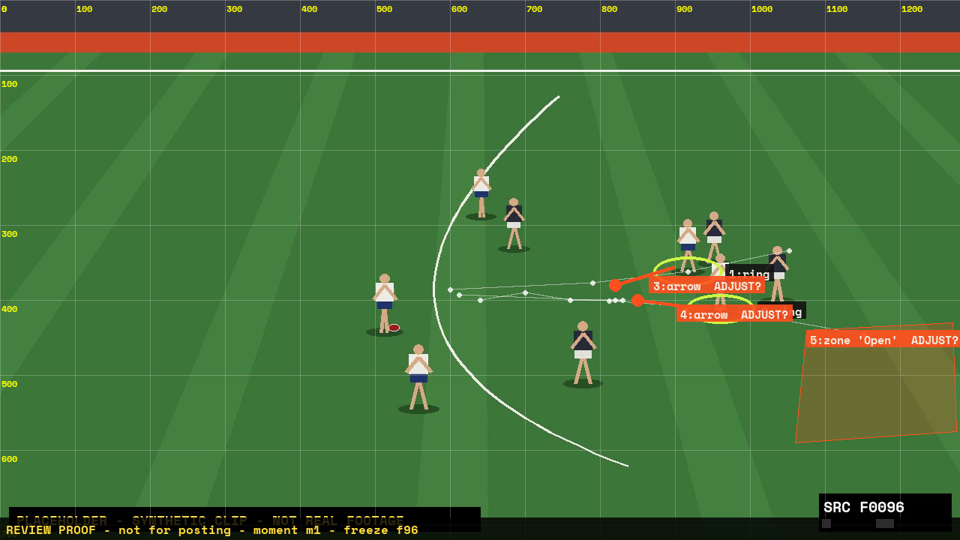
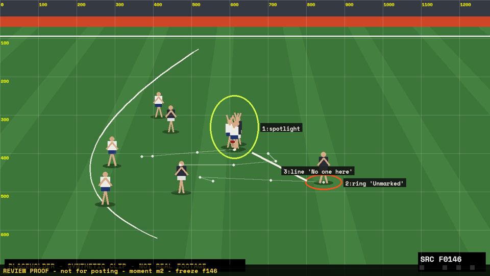

# Placeholder breakdown — review

**Status:** APPROVED by Claude (placeholder test run, not a user approval) at 2026-11-07T17:52:43

## Check these
- moment m1: track lead1 (far forward (white)) — ADJUST: At f76 he overlaps his defender and at f146 he is inside the pack: those two keys are approximate.
- moment m1: track lead2 (near forward (white)) — ADJUST: f146 key is inside the pack: approximate.
- moment m1: annotation n3 (arrow) — ADJUST: Direction from the f76→f96 screen motion; the camera pans a little, so the angle is approximate.
- moment m1: annotation n4 (arrow) — ADJUST: Direction from the f76→f96 screen motion; approximate.
- moment m1: annotation n5 (zone) — ADJUST: Marks only ground that is empty in frame; whatever is past the right edge is unknown.
- moment m2: track pack (the contest) — ADJUST: Centre of four overlapping players: approximate.

## Clips and sources

| clip | competition | match | date | source | time range | rights | proxy |
|---|---|---|---|---|---|---|---|
| c1 (PLACEHOLDER) | PLACEHOLDER (synthetic test clip) | none — synthetic | — | media/afl-breakdown/placeholder/placeholder-source.mp4 | 00:00:00.000–00:00:12.000 | placeholder | 1280×720 @ 25 fps, 300 frames |

**Vision pass:** Claude Opus 5.5 (claude-opus-5-5) in a Claude Code session. Read the three contact sheets, the signal strip and 50 px grid frames at f60, f76, f96, f120, f146, f160 and f185. Track keys are positions read off those frames (feet of each player); between them the renderer interpolates, nothing is tracked.

## Candidate moments (cheap signals → vision pass)

| # | id | frames | time | signals | visible | why it matters | status |
|---|---|---|---|---|---|---|---|
| 1 | c1-k1 [sheet](c1-k1-sheet.png) | 54–201 (peak 154) | 00:02.16–00:08.04 | crowd@f100 (6σ); pan@f54 (6σ); motion@f200 (4.7σ); concentration@f193 (3.3σ) | Wide shot. A player in a white jumper runs with the ball and kicks it at about f100. Two white-jumper forwards move toward him and end up close together, each with a dark-jumper defender near. The kick lands in a four-player contest at about f146; the ball comes out to the right and a dark-jumper player picks it up near f185. | Two teaching points: the forwards' spacing before the kick (f96), and nobody from the kicking side at ground level at the contest (f146). | chosen |
| 2 | c1-k3 [sheet](c1-k3-sheet.png) | 0–140 (peak 78) | 00:00.00–00:05.60 | crowd@f100 (6σ); pan@f3 (6σ); motion@f105 (2σ); concentration@f1 (4σ) | The same passage from the start: the ball carrier running; the forwards are mostly off the right edge until about f70. The crowd signal here is the thud of the kick at f100, not a crowd reaction. | Same play as k1. | dropped: Covered by moment m1 (same play); the lead-in on its own has no separate teaching point. |
| 3 | c1-k2 [sheet](c1-k2-sheet.png) | 211–299 (peak 268) | 00:08.44–00:11.96 | pan@f212 (6σ); concentration@f212 (3σ); after_transition@f211 | Confirmed replay: a tighter angle after a wipe, with a REPLAY bug, showing the contest again; the ball takes about twice as many frames to reach the contest as in the live shot, so it looks slowed. The four contest players overlap here too. | Would suit a contest-technique point, but body position and who touched the ball cannot be seen. | dropped: No clear teaching point visible: the players overlap at this angle as well, so nothing about the contest can be claimed. |

## Moments

### m1 — Two leads, one space.

- **Category:** spacing · **clip** c1 · in f40 (00:01.60) → **freeze f96 (00:03.84)** → out f148 (00:05.92), slow to f118
- **Teaching point:** Spacing. Two forwards leading at the kicker into the same space bring both defenders with them and leave one crowded target. Stagger the leads: one up at the ball, one holding deep or using the space the other left.
- **Proof:** 

**Claims**

- `SEEN  ` a1: The player in the white jumper on the left carries the ball and kicks it at about f100. (frames 96, 107)
- `SEEN  ` a2: Two forwards in white jumpers both move toward the ball carrier between f76 and f96 and end up close together. (frames 76, 96)
- `SEEN  ` a3: A defender in a dark jumper is within a step or two of each of those forwards at f96. (frames 96)
- `SEEN  ` a4: In frame at f96, the ground to the right of the two forwards, where the nearer one came from, has no players in it. (frames 76, 96)
- `LIKELY` a5: Leading into the same space gives the kicker one crowded target instead of two. (frames 96)
- `SEEN  ` a6: The kick lands in a contest of four players, two in white and two in dark jumpers, at about f146. (frames 120, 146)
- `UNSURE` a7: The second forward may have been told to lead there as a decoy.

**Could not tell from the footage**

- Where the second forward started: at f60 only one of the two forwards is in frame; the other comes in from the right edge around f70.
- Anything beyond the right edge of the frame (other forwards or defenders deeper in the forward line), so 'open' only means open in frame.
- Distances: the broadcast angle compresses depth, so no gap is given in metres.
- The game plan: whether either lead was planned (claim a7 stays off screen).
- Who the players are: no names or numbers are visible (synthetic placeholder).

**On screen**

- Lead-in (WATCH): "Watch the two forwards on the right." ← a2
- Freeze 1: "Two forwards lead at the same ball." ← a2
- Freeze 2: "Same space, and both defenders come too." ← a2, a3
- Freeze 3: "Better: one leads up, one holds deep." ← a4
- Outcome: "The kick lands in a two-on-two contest." ← a6

**Annotations** (video px; ADJUST = proposed from sampled frames, please check)

- n1: ring, follow
- n2: ring, follow
- n3: arrow, freeze — **ADJUST?** Direction from the f76→f96 screen motion; the camera pans a little, so the angle is approximate.
- n4: arrow, freeze — **ADJUST?** Direction from the f76→f96 screen motion; approximate.
- n5: zone “Open”, freeze — **ADJUST?** Marks only ground that is empty in frame; whatever is past the right edge is unknown.
- track lead1 (far forward (white), feet, vision): 4 keys f76–f146 — **ADJUST?** At f76 he overlaps his defender and at f146 he is inside the pack: those two keys are approximate.
- track lead2 (near forward (white), feet, vision): 4 keys f76–f146 — **ADJUST?** f146 key is inside the pack: approximate.
- track cam (camera focus, focus, vision): 5 keys f40–f148

### m2 — Nobody at the fall of the ball.

- **Category:** positioning · **clip** c1 · in f120 (00:04.80) → **freeze f146 (00:05.84)** → out f192 (00:07.68), slow to f165
- **Teaching point:** Positioning at a contest. Both forwards went up; nobody from the kicking side stayed at ground level by the contest, while one defender stayed off it and was there when the ball came out. Someone has to stay down at the fall of the ball.
- **Proof:** 

**Claims**

- `SEEN  ` b1: Four players contest the kick at about f146, two in white and two in dark jumpers, with their arms up. (frames 146)
- `SEEN  ` b2: At f146 no player in a white jumper is on the right-hand side of the contest, between it and the nearest dark-jumper player. (frames 146)
- `SEEN  ` b3: A player in a dark jumper stands off the contest, to its right, with no white-jumper player near him at f146. (frames 146)
- `SEEN  ` b4: The ball comes out of the contest to the right (f150 to f160) and that dark-jumper player picks it up at about f185. (frames 160, 185)
- `UNSURE` b5: Which player touched the ball in the contest, and whether it was a spoil or a fumble. (frames 146, 259)

**Could not tell from the footage**

- Who touched the ball in the contest, or whether it was a spoil or a fumble: the four players overlap in the wide shot and in the replay (claim b5 stays off screen).
- Body position in the contest (who was in front): the angle and the overlap hide it.
- Players outside the frame: both edges cut off the ground.
- Whether a white-jumper player was meant to be at the fall of the ball and was out of position.
- Who the players are (synthetic placeholder).

**On screen**

- Lead-in (WATCH): "Watch where the ball comes out." ← b4
- Freeze 1: "Four players go up for the mark." ← b1
- Freeze 2: "No white jumper at ground level on this side." ← b2
- Freeze 3: "One of them has to stay down." ← b2
- Outcome: "It spills right, to the unmarked defender." ← b3, b4

**Annotations** (video px; ADJUST = proposed from sampled frames, please check)

- n1: spotlight, freeze
- n2: ring “Unmarked”, follow
- n3: line “No one here”, freeze
- track pack (the contest, feet, vision): 4 keys f146–f192 — **ADJUST?** Centre of four overlapping players: approximate.
- track spare (defender off the contest (dark), feet, vision): 4 keys f146–f192
- track cam (camera focus, focus, vision): 4 keys f120–f192

## To approve

Edit moments.json if anything is wrong, re-run `python -m studio.footy check`, then `python -m studio.footy approve <moments.json> --by <your name>`. Any later edit voids the approval.
